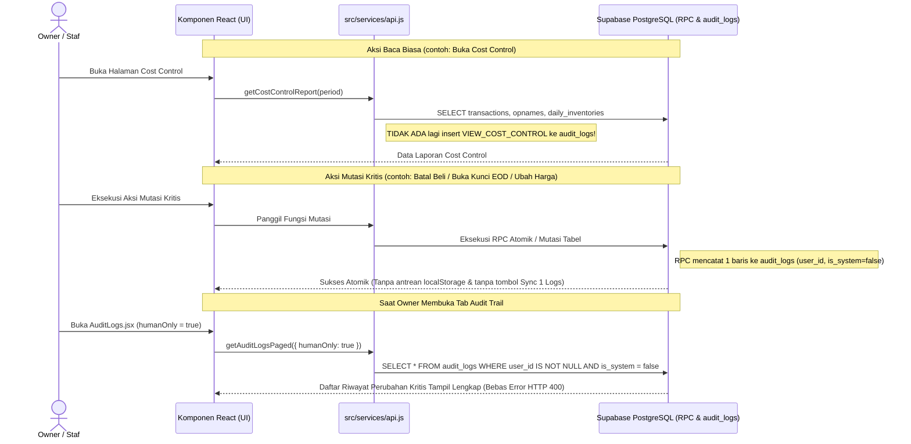

# MASTER PLANNING BLUEPRINT & WORK BREAKDOWN STRUCTURE (WBS 4-LEVEL)
## Rencana Eksekusi Upgrade UI/UX, Arsitektur Mutasi Multi-Item, Pembersihan Audit Log, dan Standardisasi Komponen Barventis V2

**Tim Penyusun:**
- **Ayling:** Lead Project Manager, System Architect & Full-Stack Engineering Lead
- **Izumi:** Evidence Traceability, Data Integrity & Quality Gate Auditor
- **Kei / Diara:** Software Blueprint Specialist, Codebase Reverse Engineer & Flow Modeler

**Target Repositori:** `Barventis-main` (`barventis-v2.vercel.app`)  
**Status Dokumen:** EXECUTION-READY BLUEPRINT & WBS  
**Tanggal Rilis:** 9 November 2026  

## 1. ARSITEKTUR PERUBAHAN SISTEM (AS-IS VS TO-BE BLUEPRINT)

Bagian ini memetakan arsitektur kode saat ini (`OBSERVED AS-IS`) terhadap arsitektur target (`TO-BE`) menggunakan standar evaluasi objektif Barventis (`Speed > Bureaucracy`, `YAGNI`, dan `Atomic Database Execution`).

### 1.1 Diagram Alir Mutasi Barang Central ke Resto (AS-IS vs TO-BE)

Status: `AS-IS vs TO-BE` (Berdasarkan inspeksi `src/pages/shared/InterBranchTransfer.jsx:56-252, 841-950` dan `src/pages/shared/Purchasing.jsx:574-755`).

```mermaid
flowchart TD
    subgraph AS_IS["Kondisi Saat Ini (AS-IS: Single-Item Native Select)"]
        A1["Staf Buka Modal Transfer"] --> A2["Tap Native Select (180+ Opsi)"]
        A2 --> A3["Scroll Manual Daftar Radio Android (Gambar 3)"]
        A3 --> A4["Input Qty 1 Barang Saja (Gambar 4)"]
        A4 --> A5["Submit RPC Satu Barang"]
        A5 -->|Jika ada 15 barang troli| A1
    end

    subgraph TO_BE["Arsitektur Target (TO-BE: Debounced Search + Multi-Item Transfer Cart)"]
        B1["Pilih Rute Header: Central Warehouse ke Resto Bar"] --> B2["Ketik Nama/SKU di Search Bar (Debounce 250ms)"]
        B2 --> B3["Tampil Maks 8 Hasil + Badge Stok Central & Resto"]
        B3 --> B4["Tap Item untuk Masuk ke Tabel Keranjang Mutasi"]
        B4 -->|Tambah barang lain| B2
        B4 --> B5["Isi Qty per Baris + Validasi Otomatis Qty <= Stok Asal"]
        B5 --> B6["Klik Konfirmasi & Transfer N Item Sekaligus"]
        B6 --> B7["Eksekusi Batch RPC Atomik (1 Nomor Surat Jalan Grup)"]
    end
```



### 1.2 Diagram Urutan (Sequence Diagram) Audit Log Bersih Tanpa Antrean LocalStorage

Status: `TO-BE` (Menggantikan `src/services/activityLogService.js:1-145` dan memperbaiki bug `src/services/api.js:3885`).



## 2. SPESIFIKASI TEKNIS PER MODUL (BLUEPRINT KOMPONEN)

### 2.1 Blueprint Modul 1: Pembersihan Audit Trail & Perbaikan Bug HTTP 400 (Gambar 1)
- **[OBJEKTIF BISNIS]:** Memulihkan tabel Audit Trail yang saat ini kosong akibat error query, menghentikan pembengkakan ribuan baris log sampah, dan menghilangkan tombol teknis `Sync 1 Logs` yang membingungkan pemilik bisnis.
- **[KRITIK ARSITEKTUR]:**
  1. Pada `src/services/api.js:3885`, klausa `query.not('actor_id', 'is', null)` merujuk pada kolom `actor_id` yang tidak pernah ada di tabel `public.audit_logs` (`supabase/migrations/20260918000000_barventis_v2_core.sql:832`).
  2. `src/services/activityLogService.js` menampung log di `localStorage` selama 5 menit, menyebabkan keterlambatan sinkronisasi dan memunculkan tombol `Sync 1 Logs` di `src/pages/shared/AuditLogs.jsx:315`.
  3. Terjadi pencatatan ganda (*double logging*) antara `api.js` (`SAVE_EOD`, `LOCK_EOD`, `UNLOCK_EOD`, `CANCEL_PURCHASE`) dan fungsi RPC di PostgreSQL (`20261020000000_daily_inventory_cost_control_v3.sql`), ditambah pencatatan aksi baca pasif `VIEW_COST_CONTROL` (`api.js:3146`).
- **[TINDAKAN TEKNIS]:**
  1. Ubah `src/services/api.js:3884-3886` menjadi:
     ```javascript
     if (humanOnly) {
       query = query.not('user_id', 'is', null).eq('is_system', false);
     }
     ```
  2. Hapus panggilan `await logAudit('VIEW_COST_CONTROL', ...)` pada `src/services/api.js:3146` dan hapus panggilan `logAudit` duplikat untuk aksi yang sudah dicatat di dalam RPC PostgreSQL.
  3. Ubah `logAudit` di `src/services/api.js:82` agar menulis langsung secara *non-blocking* ke tabel `audit_logs` di Supabase khusus untuk mutasi kritis tanpa melalui antrean `localStorage`, lalu hapus tombol `Sync 1 Logs` dan state `pendingCount` dari `src/pages/shared/AuditLogs.jsx`.
  4. Rampingkan 4 kartu KPI di `src/pages/shared/AuditLogs.jsx:150-204` menjadi *compact metric strip* 2 kolom di layar mobile agar tabel log langsung terlihat tanpa perlu menggulir jauh.

### 2.2 Blueprint Modul 2: Optimasi UI/UX & Tata Letak Halaman Cost Control (Gambar 2)
- **[OBJEKTIF BISNIS]:** Menyajikan laporan HPP bulanan yang rapi di layar ponsel, bebas dari elemen yang jebol keluar batas kartu (*horizontal overflow*), tanpa pengulangan angka yang sama di banyak kartu.
- **[KRITIK ARSITEKTUR]:**
  1. Pada `src/pages/shared/CostControl.jsx:490-520`, kontainer `Filter Tanggal` menggunakan `display: 'flex'` tanpa `flexWrap: 'wrap'` dengan dua input tanggal selebar `130px`, sehingga total lebarnya (~395px) menembus kartu mobile (~312px).
  2. Baris 397 sampai 478 merender 14 kartu dalam 3 grup terpisah, di mana angka `pemakaianBulan` ditampilkan 3 kali (di grup 1, grup 2, dan grup 3).
  3. Baris 459 memiliki karakter simbol kali yang rusak (`Theoretical COGS (ESB  Resep)`).
  4. Baris 479 sampai 481 menampilkan paragraf teknis panjang secara permanen di tengah halaman.
- **[TINDAKAN TEKNIS]:**
  1. **Konsolidasi Kartu KPI (`CostControl.jsx:397-478`):** Gabungkan ketiga blok kartu menjadi:
     - **4 Kartu Utama Eksekutif (Grid 2x2 di Mobile, 4 Kolom di Desktop):**
       1. *Total Beverage Sales (POS)*: `{formatIDR(totalSalesBeverage)}`
       2. *HPP Aktual (Rekonsiliasi Stok)*: `{formatIDR(pemakaianBulan)}` vs Target 27% (`{formatIDR(totalSalesBeverage * 0.27)}`)
       3. *Beverage Cost %*: `{beverageCostPct.toFixed(2)}%` dengan indikator warna aman (`<= 27%`)
       4. *Pemakaian Harian & Selisih*: Menampilkan *Pemakaian EOD Aktual* (`{formatIDR(actualDailyUsageCost)}`), *Theoretical COGS* (`{formatIDR(theoreticalCogsCost)}`), dan *Sesi EOD Terkunci* (`{closedEodSessions} sesi`).
     - **1 Pita Rumus HPP Ringkas (*Formula Breakdown Strip*):** Menampilkan `Stok Awal ({formatIDR(openingStock)}) + Pembelian ({formatIDR(totalPembelian)}) - Stok Akhir ({formatIDR(closingStock)}) = HPP ({formatIDR(pemakaianBulan)}) | Waste di luar HPP: {formatIDR(wasteValuation)}`.
  2. **Lipat Catatan Teknis ke Dalam Tombol Info (`CostControl.jsx:479-481`):** Tambahkan state `const [showMethodNote, setShowMethodNote] = useState(false);` yang dipicu oleh tombol kecil `(i) Catatan Metodologi Pengukuran` di samping judul ringkasan.
  3. **Perbaiki Overflow Filter Tanggal (`CostControl.jsx:485-521`):** Ubah kontainer filter tanggal agar menggunakan `display: 'flex', flexWrap: 'wrap', gap: '8px', width: '100%'` dan setiap input tanggal menggunakan `flex: '1 1 130px', minWidth: '0', maxWidth: '100%'`, sehingga pada layar ponsel kedua input tanggal selalu pas di dalam batas kartu.

### 2.3 Blueprint Modul 3: Keranjang Mutasi Multi-Item & Debounced Search (`InterBranchTransfer.jsx` - Gambar 3 & 4)
- **[OBJEKTIF BISNIS]:** Memungkinkan Barista dan Staf Gudang Central memilih puluhan barang yang akan dipindahkan dari Central ke Resto melalui pencarian instan (*debounce 250ms*) dalam satu keranjang surat jalan, sama cepatnya dengan fitur Pembelian Harian (`Purchasing.jsx`).
- **[KRITIK ARSITEKTUR]:**
  1. Saat ini `InterBranchTransfer.jsx:851-863` memakai `<select>` native atas seluruh array `stock` dan hanya memproses 1 barang per submit (`transferForm.item_id`).
  2. Rute halaman Transfer saat ini terkurung di dalam `/dashboard/sistem` (`SystemAdminHub.jsx`) yang pada `src/App.jsx:188` hanya bisa diakses oleh `ADMIN_ROLES = ['Admin / Owner', 'Owner']`, sehingga Role `Bar` dan `Central` terblokir ke `/unauthorized`.
- **[TINDAKAN TEKNIS]:**
  1. **Bangun Komponen Bersama `src/components/shared/MaterialAutocomplete.jsx`:**
     - Menerima props: `materials`, `onSelect`, `placeholder`, `sourceLocation` (`'CENTRAL'` | `'RESTO'`), `onlyInStock` (boolean opsional), dan `allowCreateNew` (opsional).
     - Menggunakan *debounce 250ms* (`useDebounce` dari `src/hooks/useDebounce.js`).
     - Menampilkan maksimal 8 hasil pencarian yang cocok berdasarkan `name` atau `sku`, lengkap dengan informasi satuan, kategori, serta lencana sisa stok (`Central: X | Resto: Y`).
  2. **Rombak Form Mutasi di `src/pages/shared/InterBranchTransfer.jsx` Menjadi Multi-Item Cart:**
     - Ganti `transferForm` tunggal dengan header rute (`source_branch`, `target_branch`, `transfer_date`, `notes`) dan state keranjang `transferCart`:
       ```javascript
       // Setiap baris di transferCart:
       {
         cart_id: string,
         material_id: number,
         name: string,
         sku: string,
         unit: string,
         category: string,
         qty_central: number,
         qty_resto: number,
         qty: string,
         item_notes: string
       }
       ```
     - Saat pengguna mengetik di `MaterialAutocomplete` dan menekan salah satu bahan, bahan tersebut langsung masuk ke `transferCart` (jika sudah ada di keranjang, fokuskan ke input `qty` baris tersebut).
     - Sediakan tombol cepat **`[+ Isi Otomatis Bahan Stok Tipis di Resto]`** (opsional 1-klik untuk memasukkan bahan yang di Resto sudah di bawah `min_stock` tetapi di Central masih tersedia).
     - Saat disubmit (`handleTransferSubmit`), sistem memvalidasi seluruh baris keranjang (`qty > 0` dan `qty <= availableSourceStock`), lalu mengeksekusi batch transfer (`Promise.all` dengan `request_key` idempoten per baris di bawah satu nomor surat jalan grup) baik untuk mode transfer langsung (`createTransfer`) maupun mode permintaan barista (`createTransferRequest`).
  3. **Buka Akses Rute `/dashboard/transfer` di `src/App.jsx` & `src/components/AppLayout.jsx`:**
     - Daftarkan rute `<Route path="transfer" element={<ProtectedRoute allowedRoles={['Admin / Owner', 'Owner', 'Supervisor', 'Central', 'Purchasing', 'Bar', 'Kitchen', 'Staff']}><RouteErrorBoundary><InterBranchTransfer /></RouteErrorBoundary></ProtectedRoute>} />` di `src/App.jsx`.
     - Tambahkan item navigasi `"Mutasi & Ambil Barang"` di sidebar `AppLayout.jsx` untuk Role `Bar`, `Central`, `Purchasing`, dan `Admin / Owner`.

### 2.4 Blueprint Modul 4: Upgrade Sistemik Lainnya (Temuan Audit Kode Sumber)
1. **Penggantian `<select>` Bahan di `WasteLogs.jsx` & `MaterialProduction.jsx`:**
   - Ganti `<select>` ratusan bahan di `src/pages/shared/WasteLogs.jsx:1171-1186` dan `src/pages/shared/MaterialProduction.jsx:167,174` dengan komponen `<MaterialAutocomplete />`.
2. **Penyelarasan Kategori `Marketlist.jsx` dengan Data Riil SO Barista 2026:**
   - Perbarui `OFFICIAL_CATEGORIES` di `src/pages/shared/Marketlist.jsx:9-19` agar mencakup ke-9 kategori baku Excel (`Coffee & Tea`, `Milk & Soft Drink`, `Drink & Beer`, `Powder`, `Syrup & Souce`, `Fresh Fruit`, `Bahan Frozen`, `Dry Goods`, `ETC`, `Extra Cost`) dan gabungkan secara dinamis dengan kategori unik yang ada di tabel `materials` database.
3. **Penggantian 4 `window.prompt()` Beruntun di `Purchasing.jsx:316-335`:**
   - Buat state `editingPurchase` dan render **Modal Edit Riwayat Pembelian** satu layar (berisi input Qty, Harga Satuan, Tanggal Kalender, dan Catatan) untuk menggantikan 4 dialog `prompt()` beruntun.
4. **Pembersihan Duplikasi Navigasi Bawah Mobile (`ContextualFloatingNav.jsx`) & Hook Reaktif `useIsMobile`:**
   - Sembunyikan `ContextualFloatingNav.jsx` pada halaman yang sudah merender `TabContainer.jsx` agar tidak menutupi tombol aksi bawah di layar ponsel.
   - Buat `src/hooks/useIsMobile.js` dengan `window.matchMedia('(max-width: 767px)')` dan gunakan di `Purchasing.jsx:104` serta `SwipeableItem.jsx:10`.

## 3. WORK BREAKDOWN STRUCTURE (WBS 4-LEVEL)

Berikut adalah dekomposisi paket kerja 4 level yang dapat langsung dijadikan daftar periksa (*checklist*) implementasi dan pemantauan:

```
====================================================================================================
MASTER WBS UPGRADE BARVENTIS V2 (UI/UX, MUTASI MULTI-ITEM, AUDIT LOG, & SYSTEM HARDENING)
====================================================================================================

1.0 KOMPONEN PENCARIAN DEBOUNCE & REDESIGN MUTASI MULTI-ITEM (SOLUSI GAMBAR 3 & 4)
    1.1 Pembangunan Komponen Bersama MaterialAutocomplete
        1.1.1 Pembuatan file src/components/shared/MaterialAutocomplete.jsx
              1.1.1.1 Implementasi input pencarian dengan useDebounce (250ms) dan ikon Search/Clear
              1.1.1.2 Implementasi filter pencocokan nama bahan, SKU, dan kategori (maksimal 8 hasil)
              1.1.1.3 Render badge stok real-time per lokasi (Stok Central vs Stok Resto) di setiap opsi
              1.1.1.4 Penanganan klik di luar dropdown (click-outside listener) dan navigasi keyboard (Arrow/Enter)
    1.2 Perombakan Modul InterBranchTransfer.jsx Menjadi Multi-Item Cart
        1.2.1 Restrukturisasi State & Header Rute Mutasi
              1.2.1.1 Ganti state transferForm tunggal menjadi routeHeader (source, target, date, notes) dan transferCart[]
              1.2.1.2 Pasang tombol Swap Rute (Central <-> Resto) yang otomatis memperbarui indikator stok asal
        1.2.2 Implementasi Tabel & Kartu Mobile Keranjang Mutasi
              1.2.2.1 Integrasikan MaterialAutocomplete di atas tabel keranjang mutasi
              1.2.2.2 Render baris keranjang (Nama, SKU, Stok Tersedia di Asal, Input Qty Transfer, Satuan, Tombol Hapus)
              1.2.2.3 Tambahkan validasi real-time: beri warna merah & peringatan jika Qty > Stok Asal
              1.2.2.4 Tambahkan tampilan kartu responsif (Swipeable/Card) untuk layar ponsel (< 768px)
        1.2.3 Eksekusi Batch Mutasi & Permintaan Transfer
              1.2.3.1 Buat handler batch submit untuk memproses seluruh item di transferCart sekaligus
              1.2.3.2 Dukung mode langsung (createTransfer untuk Central/Owner) dan mode request (createTransferRequest untuk Bar)
    1.3 Pembukaan Akses RBAC & Navigasi Rute Transfer
        1.3.1 Pembaruan Rute di src/App.jsx
              1.3.1.1 Tambahkan rute /dashboard/transfer dengan akses untuk Owner, Supervisor, Central, Purchasing, Bar, Kitchen
        1.3.2 Pembaruan Sidebar di src/components/AppLayout.jsx
              1.3.2.1 Tambahkan menu "Mutasi & Ambil Barang" pada grup navigasi Role Bar, Central, dan Admin/Owner

2.0 PEMBERSIHAN AUDIT LOGS & PERBAIKAN BUG HTTP 400 (SOLUSI GAMBAR 1)
    2.1 Perbaikan Query Backend & Eliminasi Log Sampah di src/services/api.js
        2.1.1 Perbaikan Filter Kolom Human-Only
              2.1.1.1 Ubah query.not('actor_id', 'is', null) di api.js:3885 menjadi query.not('user_id', 'is', null).eq('is_system', false)
        2.1.2 Penghapusan Log Baca & Duplikasi Log RPC
              2.1.2.1 Hapus logAudit('VIEW_COST_CONTROL') pada api.js:3146
              2.1.2.2 Hapus panggilan logAudit frontend yang duplikat dengan INSERT audit_logs di dalam RPC PostgreSQL
    2.2 Penghapusan Antrean LocalStorage & Perampingan UI AuditLogs.jsx
        2.2.1 Penyederhanaan src/services/activityLogService.js
              2.2.1.1 Ubah storeLog agar langsung mengirim mutasi penting ke server tanpa menahan di localStorage
              2.2.1.2 Bersihkan sisa kunci localStorage 'barventis_activity_logs' secara otomatis
        2.2.2 Pembaruan Antarmuka src/pages/shared/AuditLogs.jsx
              2.2.2.1 Hapus tombol "Sync 1 Logs" dan state pendingCount dari tampilan pengguna
              2.2.2.2 Padatkan 4 kartu KPI di bagian atas menjadi strip ringkas agar tabel riwayat langsung terlihat di HP

3.0 OPTIMASI UI/UX & TATA LETAK COST CONTROL (SOLUSI GAMBAR 2)
    3.1 Konsolidasi Kartu Metrik & Perbaikan Teks di src/pages/shared/CostControl.jsx
        3.1.1 Penggabungan 14 Kartu menjadi 4 Kartu Eksekutif Inti + 1 Pita Rumus HPP
              3.1.1.1 Rangkum Blok 1, 2, dan 3 (baris 397-478) agar nilai pemakaianBulan tidak terduplikasi 3 kali
              3.1.1.2 Perbaiki karakter rusak "Theoretical COGS (ESB x Resep)" pada baris 459
        3.1.2 Penataan Ulang Kotak "Catatan Pengukuran"
              3.1.2.1 Ubah paragraf catatan di baris 479-481 menjadi komponen Collapsible Info yang tertutup secara default
    3.2 Perbaikan Layout Overflow pada Filter Tanggal Tabel Harian
        3.2.1 Responsivitas Kontainer Header Daily Purchase vs Sales
              3.2.1.1 Tambahkan flexWrap: 'wrap' dan ubah lebar input tanggal dari statis 130px menjadi fleksibel (minWidth: 0, flex: 1)
              3.2.1.2 Pastikan kedua input tanggal tidak pernah menembus batas kanan kartu pada layar selebar 320px-390px

4.0 STANDARDISASI PENCARIAN BAHAN DI MODUL LIMBAH & PRODUKSI
    4.1 Upgrade Form Catat Limbah (src/pages/shared/WasteLogs.jsx)
        4.1.1 Ganti elemen <select> bahan baku (baris 1171-1186) dengan komponen MaterialAutocomplete
        4.1.2 Tampilkan stok lokasi terpilih secara langsung saat mencari bahan yang rusak/tumpah
    4.2 Upgrade Form Resep & Batch Produksi (src/pages/shared/MaterialProduction.jsx)
        4.2.1 Ganti <select> material hasil produksi (baris 167) dengan MaterialAutocomplete
        4.2.2 Ganti <select> bahan input resep (baris 174) dengan MaterialAutocomplete

5.0 SINKRONISASI KATEGORI MARKETLIST & MODAL EDIT PEMBELIAN HARIAN
    5.1 Penyelarasan Filter Kategori di src/pages/shared/Marketlist.jsx
        5.1.1 Perbarui OFFICIAL_CATEGORIES agar mencakup seluruh kategori asli SO Barista 2026
        5.1.2 Buat daftar filter kategori dinamis (gabungan OFFICIAL_CATEGORIES + kategori unik dari data materials)
    5.2 Penggantian Dialog window.prompt() Beruntun di src/pages/shared/Purchasing.jsx
        5.2.1 Ganti fungsi handleEditHistory (baris 316-335) yang memanggil 4 window.prompt() dengan state modal edit
        5.2.2 Bangun Modal Edit Pembelian (input Qty, Harga Satuan, Tanggal, dan Catatan) dengan validasi form
        5.2.3 Ganti panggilan alert() dengan notifikasi showToast() yang konsisten

6.0 PENATAAN NAVIGASI MOBILE & DETEKSI LAYAR REAKTIF
    6.1 Eliminasi Tabrakan Kapsul Navigasi Bawah (src/components/ContextualFloatingNav.jsx)
        6.1.1 Nonaktifkan ContextualFloatingNav pada rute Hub yang sudah menampilkan TabContainer di bagian atas
        6.1.2 Pastikan ruang bawah halaman bebas dari elemen melayang yang menutupi tombol simpan dan pagination
    6.2 Pembuatan Hook Reaktif src/hooks/useIsMobile.js
        6.2.1 Implementasikan hook useIsMobile berbasis window.matchMedia('(max-width: 767px)')
        6.2.2 Ganti konstanta statis window.innerWidth < 768 pada Purchasing.jsx:104 dan SwipeableItem.jsx:10

7.0 VERIFIKASI OTOMATIS, UJI REGRESI VITEST & QUALITY GATE
    7.1 Pengujian Unit & Integrasi
        7.1.1 Uji komponen MaterialAutocomplete dan keranjang mutasi multi-item
        7.1.2 Uji query getAuditLogsPaged dengan filter humanOnly = true (memastikan bebas error actor_id)
        7.1.3 Jalankan seluruh test suite Vitest (npm test) dan pastikan 100% PASS
    7.2 Validasi Build Produksi & Anti-Slop Audit
        7.2.1 Jalankan vite build untuk memastikan nol error kompilasi maupun broken imports
        7.2.2 Audit visual responsif mobile (lebar 360px) pada halaman Transfer, Cost Control, dan Audit Logs
====================================================================================================
```

## 4. MATRIKS KETERTELUSURAN & KRITERIA PENERIMAAN (ACCEPTANCE CRITERIA)

| ID WBS | Requirement & Skenario Uji (`Given - When - Then`) | File yang Dimodifikasi | Metode Verifikasi |
|:---:|:---|:---|:---|
| **WBS 1.0** | **Given** Staf membuka halaman Mutasi Antar Cabang di HP,<br/>**When** Staf mengetik nama bahan di kotak pencarian (debounce 250ms) dan memilih 5 bahan berbeda ke keranjang,<br/>**Then** Kelima bahan tampil di tabel keranjang mutasi lengkap dengan sisa stok Central/Resto dan dapat ditransfer sekaligus dalam 1 klik. | `src/components/shared/MaterialAutocomplete.jsx`<br/>`src/pages/shared/InterBranchTransfer.jsx`<br/>`src/App.jsx`<br/>`src/components/AppLayout.jsx` | Uji fungsional UI + Vitest + Build Check |
| **WBS 2.0** | **Given** Owner membuka tab Audit Trail dengan filter `Tindakan Manusia Saja` aktif,<br/>**When** Halaman memuat data dari Supabase,<br/>**Then** Query memfilter `user_id IS NOT NULL AND is_system = false` tanpa error HTTP 400, daftar log tampil utuh, dan tidak ada lagi tombol `Sync 1 Logs` maupun log sampah `VIEW_COST_CONTROL`. | `src/services/api.js`<br/>`src/services/activityLogService.js`<br/>`src/pages/shared/AuditLogs.jsx` | Vitest query inspection + Network check |
| **WBS 3.0** | **Given** Owner membuka halaman Cost Control pada layar ponsel selebar 360px,<br/>**When** Halaman merender kartu ringkasan dan tabel `Daily Purchase vs Sales`,<br/>**Then** Hanya tampil 4 kartu KPI inti + 1 pita rumus HPP (tanpa duplikasi 14 kartu), catatan teknis terlipat rapi di balik tombol info, dan input `Filter Tanggal` berada 100% di dalam batas kartu. | `src/pages/shared/CostControl.jsx` | Inspeksi layout CSS + Build Check |
| **WBS 4.0** | **Given** Barista membuka form Catat Limbah (`WasteLogs`) atau form Resep Produksi (`MaterialProduction`),<br/>**When** Barista mencari bahan baku,<br/>**Then** Pencarian menggunakan `MaterialAutocomplete` ber-debounce 250ms, bukan `<select>` native ratusan baris. | `src/pages/shared/WasteLogs.jsx`<br/>`src/pages/shared/MaterialProduction.jsx` | Inspeksi komponen + Build Check |
| **WBS 5.0** | **Given** Pengguna memfilter kategori di `Marketlist` atau mengklik tombol Edit pada riwayat `Purchasing`,<br/>**When** Filter dipilih atau tombol Edit ditekan,<br/>**Then** Seluruh kategori data riil tampil akurat dan proses edit pembelian membuka Modal Edit satu layar (bukan 4 `window.prompt()` beruntun). | `src/pages/shared/Marketlist.jsx`<br/>`src/pages/shared/Purchasing.jsx` | Uji interaksi form + Build Check |
| **WBS 6.0** | **Given** Pengguna membuka halaman Hub di perangkat mobile,<br/>**When** Pengguna menggulir ke bagian bawah halaman,<br/>**Then** Tidak ada kapsul melayang ganda yang menutupi tombol atau checkbox, dan perubahan orientasi layar terdeteksi secara reaktif via `useIsMobile`. | `src/components/ContextualFloatingNav.jsx`<br/>`src/hooks/useIsMobile.js`<br/>`src/components/shared/SwipeableItem.jsx` | Uji viewport mobile + Build Check |

## 5. URUTAN SPRINT EKSEKUSI (IMPLEMENTATION SEQUENCE)

1. **Tahap 1 (Fondasi & P0 - Langsung Terasa di Lapangan):**
   - Bangun `MaterialAutocomplete.jsx` dan `useIsMobile.js`.
   - Rombak `InterBranchTransfer.jsx` menjadi Multi-Item Transfer Cart + buka akses rute `/dashboard/transfer` untuk Role Bar & Central (**WBS 1.0**).
   - Perbaiki bug `actor_id` di `api.js:3885`, bersihkan log sampah `VIEW_COST_CONTROL`, dan sederhanakan `AuditLogs.jsx` (**WBS 2.0**).
   - Rapikan kartu KPI, lipat catatan pengukuran, dan perbaiki overflow `Filter Tanggal` di `CostControl.jsx` (**WBS 3.0**).
2. **Tahap 2 (Standardisasi UX & P1):**
   - Pasang `MaterialAutocomplete.jsx` di `WasteLogs.jsx` dan `MaterialProduction.jsx` (**WBS 4.0**).
   - Sinkronkan kategori `Marketlist.jsx` dan ganti 4 `window.prompt()` di `Purchasing.jsx` dengan Modal Edit (**WBS 5.0**).
   - Matikan duplikasi kapsul bawah di `ContextualFloatingNav.jsx` (**WBS 6.0**).
3. **Tahap 3 (Verifikasi & Bundling Paket Siap Deploy):**
   - Jalankan test suite dan `vite build` (**WBS 7.0**), lalu kemas kode yang sudah diperbarui agar siap Anda deploy ke Vercel.
