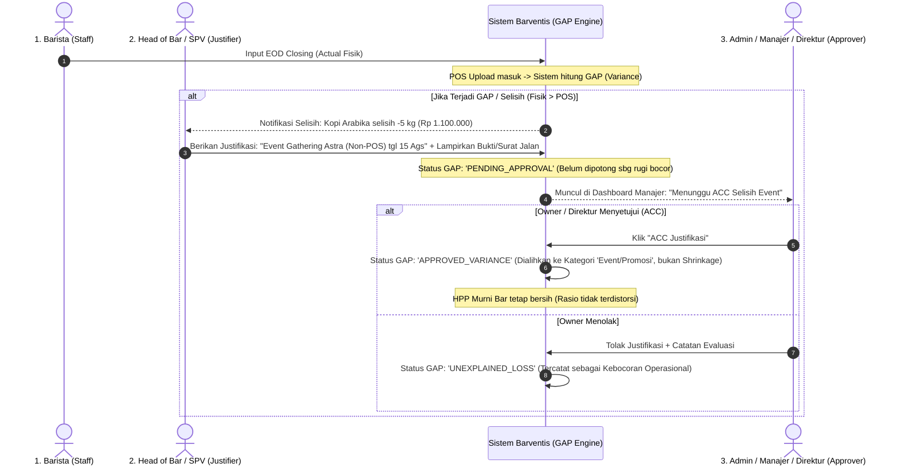

# Blueprint & Alur Governance: Rekonsiliasi GAP (Variance Justification) & Approval Hierarchy

**Author**: Ayling (Lead Autonomous Orchestrator) & Izumi (Architect) / Rafi  
**Prinsip Utama**: **Operational Reality Check (Event / Non-POS Usage vs Official Sales)**  
**Status**: APPROVED CONCEPTUAL PLANNING  

---

## 1. Kasus Nyata di Operasional Restoran & Bar

Dalam operasional harian F&B (seperti Umatis BSD & Kasuna Astra):
1. **Event Khusus / Catering / Private Gathering**:
   - Acara pernikahan atau gathering kantor yang memesan 200 cup kopi atau 50 botol sirup di luar mesin kasir biasa (penagihan via invoice terpisah atau free-flow).
   - Akibatnya: Di kasir POS ESB tidak ada struk penjualan, tetapi bahan baku fisik di bar habis keluar.
   - Tanpa sistem justifikasi, selisih ini akan dituduh sebagai **"Kebocoran / Pencurian Barista"**.
2. **Complementary / Testing Menu / Tasting Tamu VIP**:
   - Manajer resto memberikan welcome drink gratis atau barista kalibrasi rasa espresso.

---

## 2. Alur Hirarki Wewenang & Approval (Maker - Justifier - Approver)

---

## 3. Struktur Teknis di Database (Schema Extension)

Di database Supabase sudah ada tabel `public.stock_adjustments` yang memiliki kolom siap pakai:
- `id` (UUID)
- `material_id` (FK ke materials)
- `variance_qty` & `variance_pct` (Besaran GAP fisik vs teori)
- `reason` (Alasan dari Head: misal *Event Non-POS*, *Tasting VIP*, *Kalibrasi Rasa*)
- `category` (`EVENT_NON_POS`, `PROMO_COMP`, `SPILLAGE`, `SAMPLE`)
- `status` (`pending`, `approved`, `rejected`)
- `requested_by` (UUID Head Divisi Bar / Kitchen)
- `approved_by` (UUID Admin / Manajer / Direktur)
- `approved_at` (Timestamp persetujuan)
- `notes` (Catatan dari approver)

---

## 4. Rencana Tampilan Antarmuka (UI/UX)

1. **Di Halaman Daily Inventory / UsageRecap (Sisi Head of Bar)**:
   - Jika suatu baris bahan memiliki GAP merah (misal over pemakaian $> 5\%$), muncul tombol:
     `[ 📝 Beri Keterangan Selisih / Event ]`
   - Form popup ringkas:
     - *Kategori Selisih*: Event Non-POS / Catering / Kalibrasi Rasa / Uji Menu.
     - *Keterangan Alasan*: Detail event atau nomor BAP internal.
     - *Jumlah Qty Selisih*: Qty yang ingin dijustifikasi.
2. **Di Halaman Cost Control / Audit (Sisi Owner / Manajer)**:
   - Tab khusus: **"Persetujuan Selisih & Event (Variance Approval)"**.
   - Menampilkan daftar justifikasi yang diajukan Head Divisi:
     - *Siapa yang mengajukan*: Head Barista
     - *Alasan*: Event Gathering Astra (200 cup kopi)
     - *Nilai Biaya*: Rp 1.100.000
     - *Tombol*: `[ ✅ ACC / Setujui ]` dan `[ ❌ Tolak (Anggap Bocor) ]`.
3. **Dampak Langsung ke Laporan HPP**:
   - Jika di-ACC oleh Direktur, biaya tersebut tidak dihitung sebagai "Barista Shrinkage / Kerugian Bar", melainkan dialokasikan ke akun **Biaya Promosi & Event (Marketing Cost)**. HPP racikan bar tetap adil dan terkontrol.
