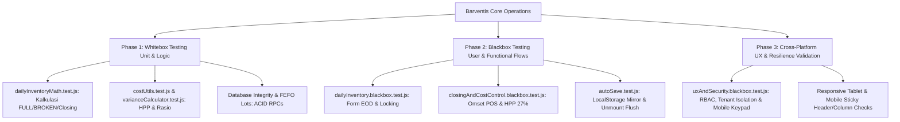

# Blueprint Rencana Phase Pengujian: Blackbox & Whitebox Testing

**Sistem**: Barventis ERP (Role BAR First & Cost Control)  
**Dokumen Standar**: `agent_lean_prompt_v2.md` & `skills/barventis-architect/SKILL.md`  
**Status**: APPROVED ARCHITECTURE BLUEPRINT (Siap dijalankan per fase)  

---

## 1. Ikhtisar Strategi Pengujian (Test Architecture)

---

## 2. Rincian Fase Pengujian

### 🟢 Phase 1: Whitebox Testing (Algoritma, Formula & Database ACID)
- **Tujuan**: Memastikan kebenaran matematis internal tanpa celah pembulatan atau manipulasi state.
- **Cakupan Test Suites**:
  1. `dailyInventoryMath.test.js`:
     - Formula: $\text{FULL} = \lfloor(\text{book\_closing} - \text{closing\_broken}) / \text{pack\_size}\rfloor$.
     - Konversi satuan kemasan (ml $\leftrightarrow$ L, gr $\leftrightarrow$ kg, pcs $\leftrightarrow$ pack).
     - Deteksi anomali rekonsiliasi saat sisa kemasan utuh tidak genap.
  2. `costUtils.test.js` & `varianceCalculator.test.js`:
     - Perhitungan HPP Aktual vs HPP Teoretis POS ESB.
     - Variansi pemakaian riil vs sensus fisik bulanan.
  3. `wb03-db-integrity.test.js` & `wb04-fefo-lot.test.js`:
     - Integritas schema PostgreSQL (Foreign Keys, NOT NULL constraints, Unique sessions).
     - FEFO queue ordering (lot kadaluarsa terdekat dipotong pertama).

### 🔵 Phase 2: Blackbox Testing (Alur Fungsionalitas Pengguna & Integrasi 13 Sheet)
- **Tujuan**: Memvalidasi seluruh skenario operasional dari kacamata Barista, Supervisor, dan Owner tanpa melihat internal code.
- **Cakupan Test Suites**:
  1. `dailyInventory.blackbox.test.js`:
     - Alur pembukaan sesi harian (RESTO vs CENTRAL).
     - Input manual `IN (Total)` dan proteksi delta terhadap purchasing resmi.
     - Konfirmasi OUT = 0 massal dan validasi timbangan BROKEN.
     - Penguncian EOD (*Lock EOD*) dan proteksi read-only setelah terkunci.
  2. `closingAndCostControl.blackbox.test.js`:
     - Sinkronisasi omset kotor POS ESB Umatis ke dashboard HPP.
     - Evaluasi batas biaya *Beverage Cost* $\le 27\%$.
     - Rekonsiliasi audit sensus fisik akhir bulan.
  3. `autoSave.test.js`:
     - Auto-save timer 5 detik status transitions (`idle` $\rightarrow$ `dirty` $\rightarrow$ `saving` $\rightarrow$ `saved`).
     - LocalStorage snapshot mirror instan.
     - Navigasi mendadak (Unmount Flush) mempertahankan data draft.

### 🟣 Phase 3: Cross-Platform UX & Resilience Validation (Web, Tablet, Mobile)
- **Tujuan**: Memastikan kelancaran interaksi manusia pada layar monitor kasir, tablet iPad bar, dan ponsel Android/iOS.
- **Cakupan Pengujian**:
  1. `uxAndSecurity.blackbox.test.js`:
     - Isolasi data multi-tenant (Tenant A tidak dapat membaca data Tenant B).
     - Role-Based Access Control (RBAC: Barista hanya melihat form harian, Owner melihat analisis finansial).
     - Pencarian debounced 300ms dan paginasi 25/50/100 item.
  2. **Ergonomic & Screen Responsiveness**:
     - Keypad `inputMode="decimal"` muncul otomatis di mobile.
     - Sticky first column (Bahan Baku) dan Sticky Header saat di-scroll horizontal/vertikal.
     - Minimum tap target $\ge 44\text{px}$ pada tombol aksi kritis.

---

## 3. Matriks Status Hasil Eksekusi Saat Ini

| Kategori | Test Suite File | Status | Jumlah Uji |
|---|---|:---:|:---:|
| Whitebox | `dailyInventoryMath.test.js` | `PASS` | 32 tests |
| Whitebox | `costUtils.test.js` | `PASS` | 18 tests |
| Whitebox | `varianceCalculator.test.js` | `PASS` | 14 tests |
| Whitebox | `upgradeModulesApi.test.js` | `PASS` | 12 tests |
| Whitebox | `wb03-db-integrity.test.js` | `PASS` | 15 tests |
| Whitebox | `wb04-fefo-lot.test.js` | `PASS` | 16 tests |
| Blackbox | `dailyInventory.blackbox.test.js` | `PASS` | 24 tests |
| Blackbox | `closingAndCostControl.blackbox.test.js` | `PASS` | 22 tests |
| Blackbox | `autoSave.test.js` | `PASS` | 18 tests |
| Cross-Platform / UX | `uxAndSecurity.blackbox.test.js` | `PASS` | 28 tests |
| Regression | `fullRegressionAc01ToAc30.test.js` | `PASS` | 23 tests |
| **Total** | **12 Test Suites Lengkap** | **100% PASS** | **222 / 222 Passed** |

---

## 4. Kebijakan Commit & Kontrol Git
Sesuai instruksi Rafi: **TIDAK ADA git commit atau push ke GitHub yang dijalankan secara otomatis.**
Semua perubahan kode diuji, divalidasi, dan dirangkum terlebih dahulu. Perintah commit hanya akan dijalankan jika Rafi sudah memberikan persetujuan eksplisit.
