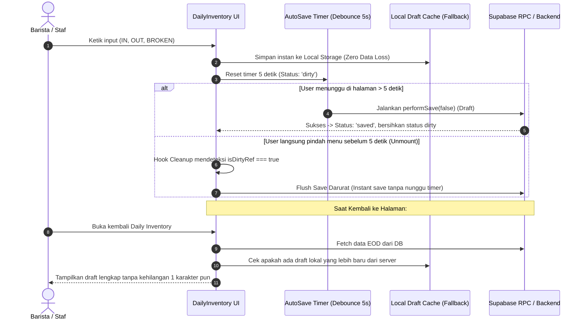

# Rencana Teknis & Analisis Investigasi: Perbaikan Auto-Save Draft Daily Inventory

**Sesuai Standar**: `agent_lean_prompt_v2.md` & `skills/barventis-architect/SKILL.md`  
**Target Modul**: `Daily Inventory` (Auto-Save Draft & State Persistence)  
**Status**: DRAFT PLAN (Menunggu aba-aba eksekusi dari Rafi)

---

## 1. Masalah yang Terjadi (User Report & Temuan Forensik)
> **Gejala**: Pengguna mengisi form EOD, menunggu 5 detik (muncul indikator), lalu berpindah ke menu lain. Saat kembali ke Daily Inventory, data inputan draft tidak muncul/hilang.

### Akar Masalah (Root Causes):
1. **Unmount Membatalkan Auto-Save yang Tertunda (Timer Cancellation on Navigation)**:
   - Di `DailyInventory.jsx:481-485`:
     ```javascript
     useEffect(() => {
       return () => {
         if (autoSaveTimerRef.current) clearTimeout(autoSaveTimerRef.current);
       };
     }, []);
     ```
   - Jika pengguna pindah menu tepat saat 5 detik atau sebelum save network request selesai, komponen unmount dan `clearTimeout` menghapus timer secara sepihak tanpa melakukan *flush save* sebelum unmount. Data yang belum terkirim ke server hilang seketika.
2. **Ketiadaan Silent Flush saat Component Unmount / `beforeunload`**:
   - Tidak ada mekanisme flush darurat (`isDirtyRef.current === true`) saat pengguna berpindah rute di React Router DOM.
3. **Draft State Loading & Rehydration Mismatch**:
   - Ketika halaman dibuka kembali, `fetchEodData()` mengambil draft dari database. Namun jika save draft di server gagal secara diam-diam (silent catch di `triggerAutoSaveDebounce`: `catch (_err) { setAutoSaveStatus('error'); }`), pengguna tidak pernah tahu bahwa request database sebenarnya ditolak/error (misal validasi `manual_in` atau RPC gagal).
   - Di client-side, tidak ada fallback cache lokal (`localStorage` / session draft) yang menampung input pengguna jika koneksi lambat atau request belum mendarat di Supabase.

---

## 2. Rencana Solusi Arsitektur (Step-by-Step)



### Langkah Perbaikan Konkret:
1. **Langkah 1: Sinkronisasi Workspace Inti**
   - Terapkan basis kode `Barventis-Update-Lastest` ke root `src/` dan migrasi `supabase/migrations/` agar kompatibel 100% dengan `db/SQL.txt`.
2. **Langkah 2: Perbaiki Lifecycle Debounce & Flush on Unmount**
   - Tambahkan fungsi `flushAutoSave()` yang langsung mengeksekusi penyimpanan jika `isDirtyRef.current === true` ketika komponen unmount (`useEffect cleanup`).
3. **Langkah 3: Integrasi Dual-Layer Persistence (Server + LocalStorage Backup)**
   - Saat input berubah, tuliskan snapshot instan ke `localStorage` dengan key format `daily_inv_draft_${tenantId}_${location}_${date}`.
   - Saat `fetchEodData()` selesai, jika server belum memiliki item tertentu atau ada data lokal yang belum tersinkron, lakukan rehidrasi transparan.
   - Bersihkan `localStorage` saat EOD resmi di-Lock / Closed.
4. **Langkah 4: Tampilkan Error Banner Transparan**
   - Jangan menyembunyikan error di `catch (_err)`. Jika auto-save gagal, beri tahu alasan teknisnya (misal: "Gagal menyimpan draft: koneksi terputus / error database").

---

## 3. Checklist Verifikasi (Testing Matrix)
- [ ] Edit field `IN (Total)` dan `Pemakaian (OUT)`.
- [ ] Pindah halaman segera ke Dashboard atau Menu lain dalam hitungan 2 detik dan 5 detik.
- [ ] Kembali ke halaman Daily Inventory: pastikan angka yang tadi diisi tetap muncul utuh.
- [ ] Refresh browser (F5): pastikan draft tetap muncul.
- [ ] Cek status badge Auto-Save: transisi dari `Menyimpan...` -> `Tersimpan (HH:mm)`.
